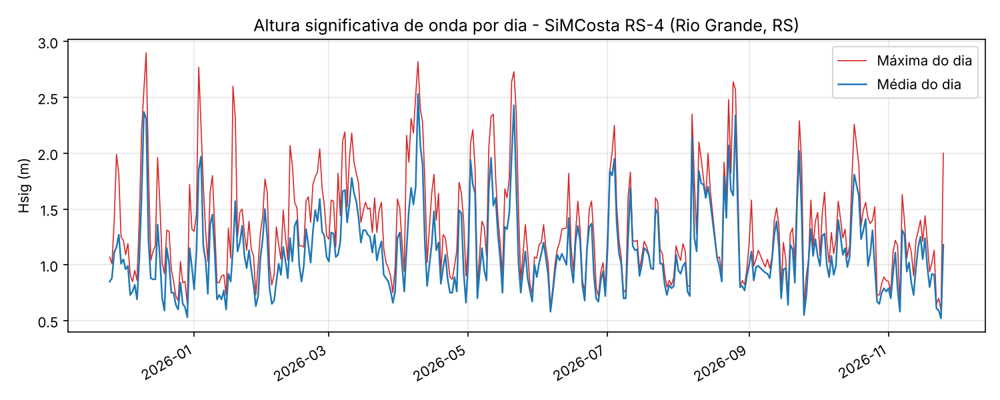
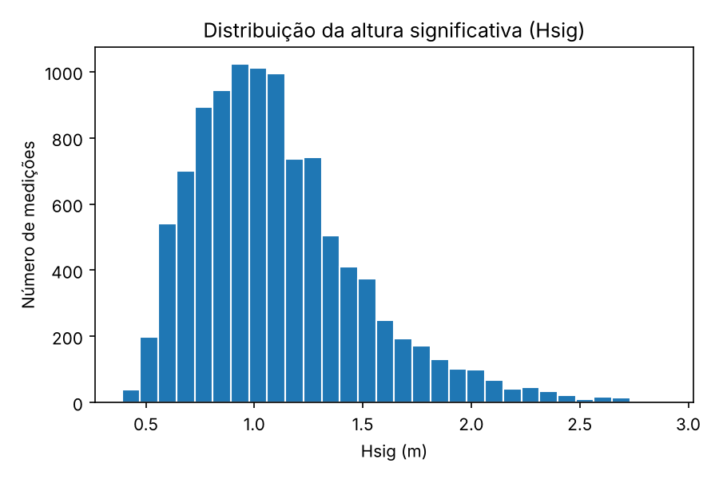

# Análise de ondas e correntes da boia SiMCosta RS-4 (Rio Grande, RS)

Projeto de estudo em Python e SQL: um pipeline ETL simples que lê dados reais de uma boia
meteo-oceanográfica, limpa os dados, guarda tudo em um banco SQLite e gera estatísticas e gráficos.

Ondas e correntes são condições ambientais que atuam sobre sistemas de fundeio de boias,
tema que estudo no doutorado em Engenharia Oceânica (FURG).

## O que o projeto faz

1. **Extract:** lê os arquivos CSV baixados do SiMCosta (ondas e correntes).
2. **Transform:** monta a data e hora (UTC e hora local), remove valores faltantes e fisicamente
   impossíveis, tira linhas repetidas e calcula um resumo por dia.
3. **Load:** grava os dados em um banco SQLite (`data/simcosta.db`) com três tabelas:
   `ondas`, `correntes_superficie` e `resumo_diario`.
4. **Análise:** executa consultas SQL (`sql/consultas.sql`) e gera dois gráficos.

## Dados

- **Fonte:** Sistema de Monitoramento da Costa Brasileira (SiMCosta), estação **RS-4**
  (lat. -32,2487; lon. -52,1000; profundidade 13 m), dados nível L1.
- **Período baixado:** 25/11/2025 a 25/11/2026.
- **Ondas:** altura significativa (Hsig), altura da maior onda (Hmax), altura média (Havg),
  período significativo (Tsig) e direção média, a cada 30 minutos.
- **Correntes:** perfilador ADCP; usei apenas a primeira célula (0,71 m de profundidade).
  A velocidade vem em mm/s e é convertida para m/s.

Os dados brutos **não estão neste repositório**. Para reproduzir:

1. Faça o cadastro gratuito em [simcosta.furg.br](https://simcosta.furg.br) e leia os termos de uso.
2. Baixe, para a estação RS-4 e o período desejado, os arquivos de ondas (`OCEAN`) e de correntes
   (`CURR`) em formato `.csv`.
3. Coloque os arquivos na pasta `data/raw/`.

## Como rodar

```bash
pip install -r requirements.txt
python src/etl.py       # cria o banco data/simcosta.db
python src/analise.py   # roda as consultas e gera os gráficos em resultados/
```

## Resultados

Com os dados baixados, depois da limpeza ficaram 10.324 medições de ondas (de 10.335 lidas)
e 1.715 de correntes.

- Altura significativa média de ondas no período: cerca de 1,1 m.
- Maior altura significativa: 2,90 m, em 11/12/2025 (maior onda individual de 5,46 m).
- Os meses de março a maio e agosto tiveram as médias mensais mais altas (acima de 1,2 m).




## Limitações

- Há falhas nos dados: o número de medições por mês varia bastante, e o arquivo de correntes
  vai só até 14/06/2026.
- O arquivo meteorológico (vento) da estação veio sem nenhuma linha de dados e por isso não foi usado.
- Análise exploratória básica, feita para estudo. Os dados do SiMCosta não devem ser usados
  para fins operacionais ou de navegação, conforme o aviso do próprio SiMCosta.

## Créditos

Dados cortesia do Sistema de Monitoramento da Costa Brasileira (SiMCosta,
[www.simcosta.furg.br](https://www.simcosta.furg.br)), Universidade Federal do Rio Grande (FURG).

## Estrutura

```
src/etl.py           pipeline ETL
src/analise.py       consultas e gráficos
sql/consultas.sql    consultas SQL
resultados/          gráficos e resumo diário
data/raw/            arquivos CSV do SiMCosta (não versionados)
```
